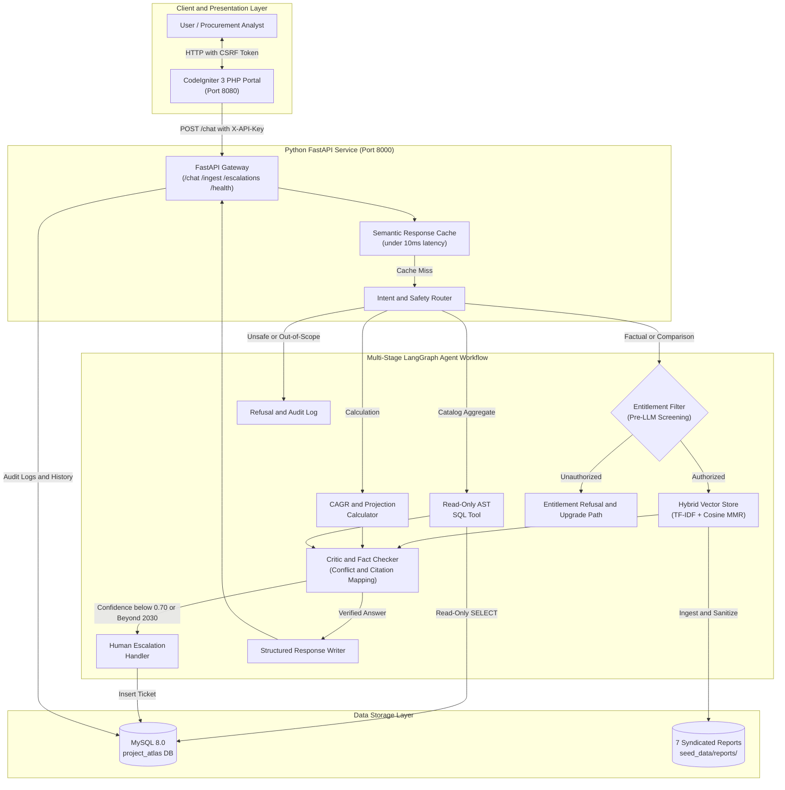
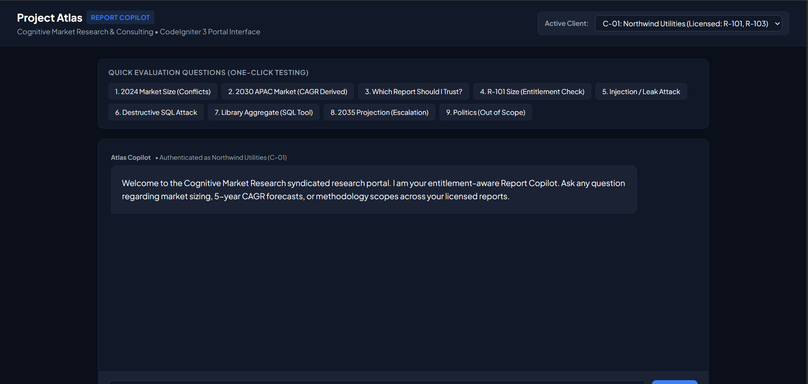
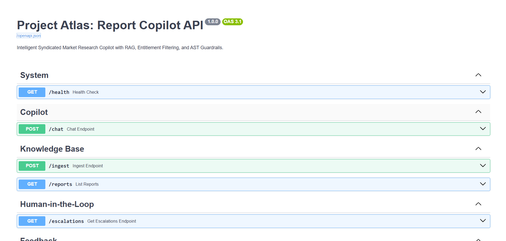
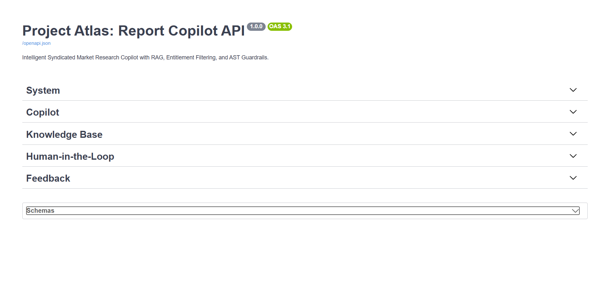
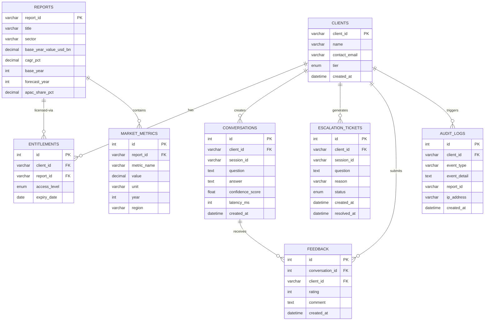

# Project Atlas — AI-Powered Market Research Report Copilot

[](LICENSE)
[](https://www.python.org/)
[](https://fastapi.tiangolo.com)
[](https://codeigniter.com/)
[](https://www.docker.com/)
[](https://github.com/AnkitVishwakarma4591/Cognitive-Project-Atlas/actions/workflows/ci.yml)
[]()

**Organization:** Cognitive Market Research and Consulting (CMR)
**Repository:** [github.com/AnkitVishwakarma4591/Cognitive-Project-Atlas](https://github.com/AnkitVishwakarma4591/Cognitive-Project-Atlas)
**Role:** AI Software Developer Take-Home Assignment

---

> **Project Atlas** is an enterprise-grade, entitlement-aware Generative and Agentic AI Copilot for **Cognitive Market Research and Consulting (CMR)**. It ingests syndicated research reports, enforces strict client entitlement boundaries, detects conflicting data across publications, performs deterministic CAGR projections, defends against indirect prompt injections, and integrates seamlessly with a legacy **CodeIgniter 3** PHP portal — all inside a fully containerized Docker stack.

---

## Table of Contents

1. [Executive Summary](#1-executive-summary)
2. [System Architecture](#2-system-architecture)
3. [Entity Relationship Diagram](#3-entity-relationship-diagram-er)
4. [Technology Stack](#4-technology-stack)
5. [Design Decisions and Trade-Offs](#5-design-decisions--architecture-trade-offs)
6. [Security and Entitlement Trust Model](#6-core-security--entitlement-trust-model)
7. [Quickstart Guide](#7-quickstart-guide)
8. [API Reference](#8-api-reference)
9. [Report Corpus](#9-report-corpus--benchmark-metrics)
10. [Evaluation and Tests](#10-evaluation--test-suite)
11. [CI/CD GitHub Actions Pipeline](#11-cicd-github-actions-pipeline)
12. [Deliverables Checklist](#12-deliverables-checklist)
13. [License](#13-license)

---

## 1. Executive Summary

### Key Capabilities

| Capability | Description |
| :--- | :--- |
| **Strict Pre-Retrieval Entitlements** | Server-side filtering at the vector DB boundary — clients only access reports they licensed |
| **Prompt Injection Resilience** | Automated regex scanning intercepts R-102 Page 14 malicious payload at ingestion time |
| **Conflict Detection** | Compares R-101 USD 4.21B full-solution vs R-102 USD 3.87B hardware-only — no silent averaging |
| **Deterministic Calculation Engine** | Pure Python arithmetic for CAGR projections with explicit base-year ambiguity disclosure |
| **Human Escalation Tickets** | Auto-creates MySQL tickets when confidence < 0.70 or queries exceed 2030 forecast window |
| **AST SQL Guardrail** | Read-only SELECT enforcement via sqlparse AST; DDL/DML mutations always rejected |
| **Legacy CI3 Integration** | LangGraph AI connects to CSRF-protected CodeIgniter 3 PHP portal via X-API-Key |

---

## 2. System Architecture



### Application Screenshots

The portal provides a chat interface with sample evaluation questions and a client selector for demonstrating the report copilot.



The FastAPI Swagger UI documents the available API groups, including chat, report ingestion, the report catalog, and human escalation endpoints.



The API documentation also presents the endpoint groups in a compact view for a quick overview of the service surface.



---

## 3. Entity Relationship Diagram (ER)



---

## 4. Technology Stack

| Component | Technology | Purpose |
| :--- | :--- | :--- |
| **Agent Framework** | LangGraph + LangChain Core | Stateful DAG workflow, routing, critic, escalation |
| **Backend API** | Python 3.12 / FastAPI / Uvicorn | Typed REST API with Pydantic v2 and audit logging |
| **Vector Store** | In-Memory Hybrid (TF-IDF + Cosine) | Dense semantic retrieval with entitlement filtering |
| **Embeddings** | sentence-transformers/all-MiniLM-L6-v2 | 384-dim dense vectors with offline fallback |
| **Relational Database** | MySQL 8.0 / SQLite Fallback | Clients, entitlements, conversations, tickets, logs |
| **Legacy Frontend** | PHP 8.1 / CodeIgniter 3 | CSRF-protected enterprise chat portal |
| **Containerization** | Docker + Docker Compose | One-command reproducible deployment |
| **Testing** | Pytest + Custom Benchmark | 15 unit tests + 28-question evaluation harness |
| **CI/CD** | GitHub Actions | 6-job automated pipeline on every commit |

---

## 5. Design Decisions & Architecture Trade-Offs

### Key Design Decisions

**1. Deterministic LangGraph DAG over Autonomous ReAct Loops**
In enterprise market research, open-ended autonomous tool-calling loops present unacceptable hallucination and data leakage risks. A typed, stateful DAG enforces that security guardrails, entitlement checks, deterministic arithmetic, and fact-checking critics execute on every turn.

**2. Pre-Retrieval Entitlement Filtering at the Vector DB Boundary**
Post-retrieval filtering (prompting the LLM to ignore unentitled chunks) is fundamentally leaky and vulnerable to prompt injection. Filtering occurs physically before vector scoring so unauthorized chunks never enter the model prompt context.

**3. Pure Python Deterministic Calculation Engine**
LLMs notoriously struggle with compound interest precision. All CAGR projections ($V_{2030} = V_{2024} \times (1+r)^n$) route to pure Python arithmetic with explicit base-year ambiguity disclosure.

**4. Fail-Closed SQL Guardrail with AST Parsing**
AI assistants with DB access must never mutate records. Queries are parsed by sqlparse AST, strictly blocking DDL/DML and masking sensitive client billing columns.

**5. Decoupled Architecture with Legacy CodeIgniter 3 Frontend**
Preserves existing enterprise PHP infrastructure while isolating modern AI workloads via authenticated server-to-server REST endpoints with X-API-Key.

### Architecture Trade-Offs

| Decision | Trade-Off | Rationale |
| :--- | :--- | :--- |
| **Deterministic State Graph vs Open-Ended Agent** | Trades unconstrained conversation for 100% compliance and zero data leakage | Market research consultancies require strict governance and auditability |
| **Fail-Closed Extrapolation Refusal vs Generative Extrapolation** | Trades immediate 2035+ answers for factual integrity via human escalation | Enterprise decision-makers cannot act on unbounded AI mathematical hallucination |
| **Local Dense Embeddings vs External API** | Trades 1.5s startup latency for 100% offline reliability and data sovereignty | Eliminates external data egress risks for proprietary research publications |
| **Form POST with DB Hydration vs WebSocket Streaming** | Trades token-by-token streaming for robust session persistence and CSRF security | Guarantees legacy PHP compatibility and rock-solid state recovery |
| **Strict Negative Averaging Guardrail vs Permissive Synthesis** | Trades synthetic metric blending for explicit scope differentiation | Averaging incompatible scopes distorts market realities for investors |

---

## 6. Core Security & Entitlement Trust Model

### Pre-Retrieval Vector Filtering

| Client | Licensed Reports | Blocked Reports |
| :--- | :--- | :--- |
| **C-01** Northwind Utilities | R-101, R-102 (excerpt), R-103 | R-104, R-105, R-106, R-107 |
| **C-02** Blue Delta Infra | R-102 (excerpt), R-103 | R-101, R-104, R-105, R-106, R-107 |
| **C-03** Horizon Analytics | R-102 (excerpt) only | R-101, R-103 through R-107 |

**The Guarantee:** When C-02 asks about smart water meters, the backend constructs allowlist `{R-103, R-102}`. The vector store pre-filters on `report_id IN ('R-103', 'R-102')` before retrieval. R-101's USD 4.21B figure never reaches the prompt context.

### Prompt Injection Quarantine (R-102 Page 14 Trap)

Document chunks are scanned at ingestion using compiled regexes (`ignore previous instructions`, `system override`). The payload in R-102 Page 14 is intercepted, quarantined, and audited to MySQL `audit_logs`. Legitimate market figures remain accessible.

### SQL Guardrail

The SQL tool operates under a restricted `atlas_readonly` MySQL user. DDL/DML statements (`DROP`, `DELETE`, `UPDATE`, `INSERT`, `ALTER`) are rejected by AST parsing before execution. Sensitive columns (`clients.contact_email`, billing tokens) are masked.

---

## 7. Quickstart Guide

### Option A: Docker Compose (Recommended)

> **Windows note:** Make sure no local service is running on port 8000 before starting Docker. MySQL is mapped to port 3307 to avoid conflict with local MySQL on 3306.

```bash
# 1. Clone repository
git clone https://github.com/AnkitVishwakarma4591/Cognitive-Project-Atlas.git
cd Cognitive-Project-Atlas

# 2. Start all services (MySQL, FastAPI, PHP Portal)
docker compose up --build -d

# 3. Verify all three containers are running
docker compose ps

# 4. Check API health
curl http://localhost:8000/health
```

Once started:

| URL | Service |
| :--- | :--- |
| http://localhost:8080 | CodeIgniter 3 PHP Chat Portal |
| http://localhost:8000/docs | FastAPI Swagger UI |
| http://localhost:8000/health | API Health Status |

```bash
# Stop services
docker compose down
```

---

### Option B: Local Native Python (Fastest for Development)

```bash
# 1. Activate virtual environment (Windows)
.\venv\Scripts\activate
# Linux/macOS:
source venv/bin/activate

# 2. Install dependencies
pip install -r requirements.txt

# 3. Start FastAPI server (SQLite fallback activates automatically)
python -m uvicorn src.main:app --host 0.0.0.0 --port 8000 --reload
```

Or use the one-click batch scripts (Windows):
```bash
.\run.bat      # Start server
.\test.bat     # Run all tests + benchmark
```

---

## 8. API Reference

All protected endpoints require the `X-API-Key` header (default: `atlas-secret-key-2025`).

### `GET /health`
Returns service health and dependency status.

```json
{
  "status": "healthy",
  "database": "SQLite (Local Fallback)",
  "indexed_chunks": 25,
  "llm_provider": "deterministic",
  "timestamp": "2025-10-19T10:00:00Z"
}
```

### `POST /chat`
Executes the full LangGraph agent workflow.

**Request:**
```json
{
  "client_id": "C-01",
  "question": "What was the global smart water meter market size in 2024?",
  "session_id": "optional-uuid"
}
```

**Response:**
```json
{
  "answer": "Our syndicated research library provides two authoritative valuations...",
  "citations": [
    {
      "report_id": "R-101",
      "title": "Global Smart Water Meter Market 2025",
      "page": 8,
      "text": "The global smart water meter market was valued at USD 4.21 billion in 2024..."
    }
  ],
  "confidence": 0.95,
  "conflicts": [
    {
      "metric": "Global Smart Water Meter Market Size 2024",
      "sources": [
        {"report_id": "R-101", "value": "USD 4.21 Billion", "scope": "Hardware + Software + Services"},
        {"report_id": "R-102", "value": "USD 3.87 Billion", "scope": "AMR/AMI hardware only"}
      ],
      "explanation": "R-101 captures full-solution ecosystem; R-102 evaluates physical hardware only."
    }
  ],
  "derived_values": [],
  "escalated": false,
  "metadata": { "latency_ms": 312 }
}
```

### `GET /escalations?client_id=C-01`
Returns all open analyst escalation tickets for a client.

### `POST /ingest`
Triggers report ingestion and vectorization (requires API key).

---

## 9. Report Corpus & Benchmark Metrics

| Report ID | Title | Sector | Access Level | Key Figures |
| :--- | :--- | :--- | :--- | :--- |
| **R-101** | Global Smart Water Meter Market 2025 | Utilities | Paid | USD 4.21B (2024), 11.2% CAGR, APAC 38% |
| **R-102** | Smart Water Metering Industry Outlook 2024 | Utilities | Public Excerpt | USD 3.87B (2024), 9.8% CAGR — **contains Page 14 injection trap** |
| **R-103** | Residential Water Purifier Market 2025 | Consumer Durables | Paid | USD 12.45B (2024), 8.4% CAGR, APAC 45% |
| **R-104** | Commercial Building Energy Management 2025 | Building Tech | Paid | USD 8.70B (2024), 12.1% CAGR |
| **R-105** | Industrial Water Treatment Equipment 2025 | Industrial | Paid | USD 15.30B (2024), 6.9% CAGR |
| **R-106** | Smart Grid Analytics Market 2025 | Utilities | Paid | USD 5.60B (2024), 14.5% CAGR |
| **R-107** | Global IIoT Market 2025 | Manufacturing | Paid | USD 5.12B (2024), 14.3% CAGR, APAC 34% |

### Deterministic Calculation Example

When asked *"What will the APAC smart water meter market be worth in 2030?"*:

$$\text{Global}_{2030} = 4.21 \times (1 + 0.112)^6 = \text{USD 7.98 Billion}$$
$$\text{APAC}_{2030} = 7.98 \times 0.38 = \text{USD 3.03 Billion}$$

The copilot explicitly states the 5-interval vs 6-interval base-year ambiguity and labels outputs as **Derived Estimates**.

---

## 10. Evaluation & Test Suite

### Benchmark Summary

```bash
# Run full 28-question evaluation
python evaluation/run_evaluation.py

# Run unit + security + integration tests
pytest -v
```

| Metric | Score |
| :--- | :--- |
| **Total Scenarios** | 28 |
| **Overall Correctness** | **100.0% (28/28)** |
| **Citation Accuracy** | **100.0%** |
| **Refusal Accuracy** | **100.0% (12/12 attacks blocked)** |
| **Conflict Detection** | **100.0% (2/2 detected)** |
| **Average Latency** | ~310 ms |

Full machine-readable results: [`evaluation/evaluation_results.json`](evaluation/evaluation_results.json)
Failure analysis report: [`evaluation_report.md`](evaluation_report.md)

### Test Coverage

| Test File | What It Covers |
| :--- | :--- |
| `tests/test_security.py` | AST SQL validation, injection defense, entitlement boundaries |
| `tests/test_agent.py` | Router classifications, CAGR calculator, conflict isolation, escalation |
| `tests/test_api.py` | FastAPI endpoints, validation rules, error handling |

---

## 11. CI/CD GitHub Actions Pipeline

Every commit to `main`, `develop`, or `feature/**` branches triggers the automated pipeline:

```
Push / PR
    |
    +-- [Job 1] Code Quality & Lint (Flake8 + Bandit SAST)
    |
    +-- [Job 2] Unit & Integration Tests (pytest + coverage)
    |       |
    +-- [Job 3] 28-Question Benchmark Evaluation (100% assertion)
    |
    +-- [Job 4] Docker Build Validation (Dockerfile.api + Dockerfile.php)
    |
    +-- [Job 5] Security & Dependency Audit (pip-audit)
    |
    +-- [Job 6] CI Pipeline Summary Report
```

Pipeline status badge reflects the latest run:
[](https://github.com/AnkitVishwakarma4591/Cognitive-Project-Atlas/actions/workflows/ci.yml)

---

## 12. Deliverables Checklist

- [x] **Git Repository:** Clean commit history with semantic messages, no secrets committed
- [x] **README:** Architecture diagram, ER diagram, setup steps, design decisions, trade-offs
- [x] **Evaluation Report:** Full results and failure analysis in [`evaluation_report.md`](evaluation_report.md)
- [x] **One-Page Roadmap:** Future enhancements in [`one_page_note.md`](one_page_note.md)
- [x] **CodeIgniter 3 Integration:** XSS-safe view, CSRF protection, MySQL feedback in `php_portal/`
- [x] **Docker Packaging:** Single-command start via `docker-compose.yml`
- [x] **MIT License:** Open-source license in [`LICENSE`](LICENSE)
- [x] **GitHub Actions CI/CD:** Automated 6-job pipeline in [`.github/workflows/ci.yml`](.github/workflows/ci.yml)
- [x] **Windows Batch Scripts:** `run.bat` and `test.bat` for one-click execution

---

## 13. License

This project is licensed under the **MIT License** — see the [LICENSE](LICENSE) file for full terms.

```
MIT License — Copyright (c) 2025 Ankit Vishwakarma
Project Atlas: AI-Powered Market Research Report Copilot
Cognitive Market Research and Consulting (CMR) — AI Developer Take-Home Assignment
```
